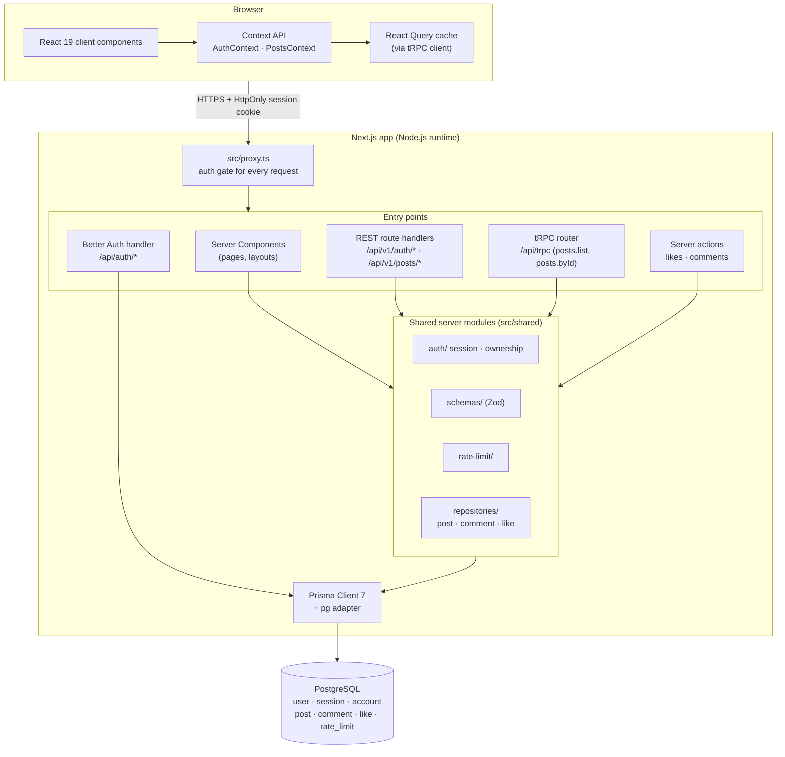
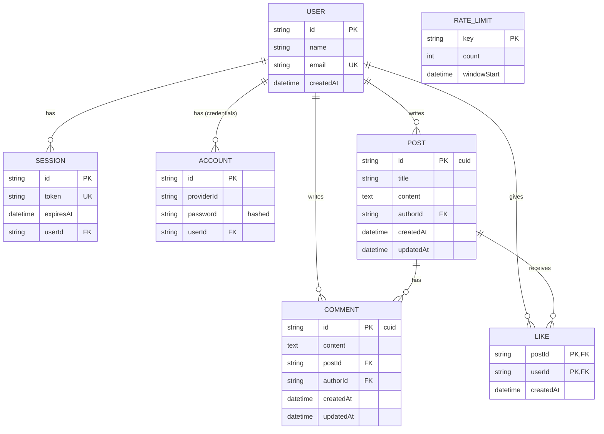
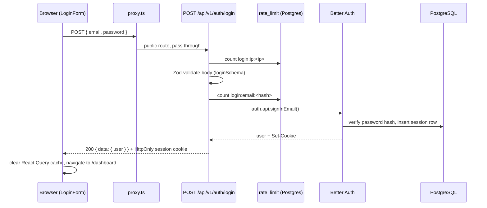
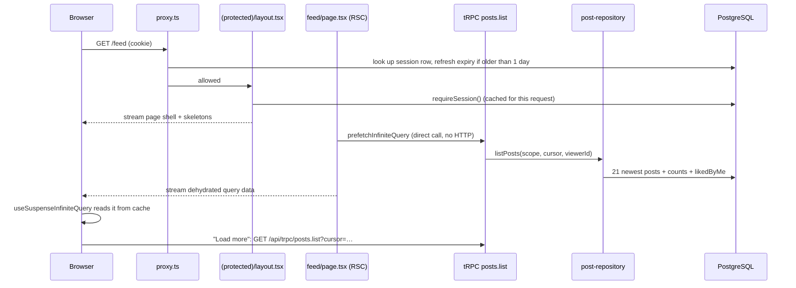
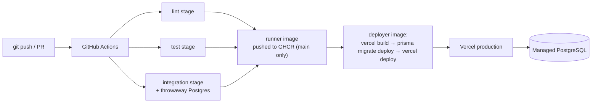

# Inkwell: System Design

Inkwell is a blogging platform. Signed-in users write posts, read a feed of everyone's posts, comment and like. This document describes how it is built, how the pieces talk to each other, how data moves through the system, and why it was built this way.

## 1. Goals and constraints

| Goal | What it means for the design |
| --- | --- |
| Authenticated blogging: posts, comments, likes | One relational data model with clear ownership (every post and comment has an `authorId`). |
| Secure by default | Every request is checked twice (a gate in front, then the handler itself). Sessions can be revoked instantly. Abuse is rate limited. |
| Fast first paint | Server rendering with streaming: the page shell appears at once and data fills in behind skeletons. |
| Simple to run and deploy | One Next.js app and one PostgreSQL database. No separate API server, cache or queue to operate. |
| Easy to change safely | Type safety from the database to the browser, shared validation schemas, and unit plus integration tests in CI. |

## 2. Architecture overview

Inkwell is a **modular monolith**: a single Next.js 16 (App Router) application that serves both the UI and the APIs, backed by a single PostgreSQL database.

### Layers

| Layer | Location | Responsibility |
| --- | --- | --- |
| **Proxy (gate)** | `src/proxy.ts` | Runs before every request. Classifies it (public page, protected page, protected API, server action), validates the session against the database, refreshes the sliding session cookie, and rejects early with a redirect or `401`. |
| **Routes / UI** | `src/app/` | Route groups: `(marketing)` landing page, `(authentication)` login and register, `(protected)` dashboard, feed, post pages. Server Components fetch data; client components handle interaction. |
| **API entry points** | `src/app/api/` | REST route handlers for auth and post writes, the tRPC endpoint for post reads, and Better Auth's own handler. |
| **Server actions** | `src/shared/actions/` | Likes and comments, called directly from client components. |
| **Auth** | `src/shared/auth/` | Better Auth configuration, `getServerSession()` / `requireSession()`, and ownership checks (`assertPostAuthor`, `assertCommentAuthor`). |
| **Validation** | `src/shared/schemas/` | Zod schemas shared by the browser forms and the server handlers. |
| **Rate limiting** | `src/shared/rate-limit/` | A fixed-window limiter stored in Postgres. |
| **Data access** | `src/shared/repositories/` | All database queries. Nothing else talks to Prisma directly (apart from Better Auth's adapter and the rate limiter). |
| **Persistence** | `prisma/schema.prisma`, `src/shared/db/db.ts` | Prisma schema, migrations, and one shared Prisma client using the `pg` driver adapter. |
| **Client state** | `src/shared/state/` | `AuthContext` (sign in/up/out, current user) and `PostsContext` (read and change posts), on top of React Query. |

## 3. Components and how they interact

### 3.1 Four entry points, one core

The app exposes four kinds of server entry points. Each one is chosen for what it does best, but they all funnel into the **same** auth, validation, ownership and repository modules, so the rules live in one place.

| Entry point | Used for | Why this mechanism |
| --- | --- | --- |
| **REST** (`/api/v1/auth/*`, `/api/v1/posts/*`) | Register, login, logout; create, update, delete posts | Writes with clear HTTP semantics (`201`, `204`, `403`, `409`, `429`). A documented, stable JSON contract any client can call (curl, mobile, tests). |
| **tRPC** (`/api/trpc`) | `posts.list` (paginated feed), `posts.byId` | End-to-end types for reads with no hand-written client. Integrates with React Query for caching, infinite scrolling and server prefetch. `superjson` keeps `Date`s as `Date`s. |
| **Server actions** | Like/unlike, add/edit/delete comment | Small mutations triggered from inside a post page. No endpoint boilerplate, and `refresh()` re-renders the server data right after. |
| **Server Components** | Rendering pages | Read data on the server close to the database and stream HTML. No API round trip for the first render. |

### 3.2 Why post reads use tRPC instead of REST

Reading posts (the paginated list and a single post) is served by tRPC rather than by `GET` endpoints on the REST API. This is a deliberate decision, not an omission.

**Background.** tRPC was raised by the hiring team during the recruitment process. It was therefore adopted here on purpose, as an opportunity to learn the technology and evaluate it on a real feature rather than in isolation. Reads were chosen as the place to apply it because they benefit most from what tRPC offers, while writes remain on REST, where explicit HTTP status codes and a documented JSON contract matter most.

**What tRPC brings to the read path.**

- **End-to-end type safety.** The return types of `posts.list` and `posts.byId` (`PostSummary`, `PostDetail`) flow directly to the client, with no hand-written API client and no duplicated response types.
- **React Query integration.** Caching, cursor-based infinite scrolling ("Load more") and server-side prefetch with hydration come from the tRPC/React Query bindings, so the first page of posts arrives with the HTML.
- **Precise cache invalidation.** After any change to posts, `PostsContext` invalidates exactly the affected queries (`trpc.posts.pathFilter()`), keeping the dashboard, feed and post page consistent.
- **Faithful serialization.** `superjson` delivers `Date` values as `Date` objects rather than strings.

**Why this does not weaken the API.** The tRPC procedures (`src/shared/trpc/routers/posts.ts`) apply the same safeguards as the REST handlers. They are behind the proxy gate and `protectedProcedure`'s own session check. Their inputs are validated with Zod. They call the same repository functions (`listPosts`, `getPost`), so they return the same email-free DTOs. Their errors pass through `errorFormatter`, which never exposes stack traces.

**Trade-off.** A client outside this codebase cannot read posts through a resource-oriented REST URL. tRPC queries are plain HTTP `GET` requests (`/api/trpc/posts.list?input=…`), but their input and output use tRPC's superjson envelope rather than a conventional REST shape. If REST reads become necessary, adding `GET /api/v1/posts` and `GET /api/v1/posts/:postId` is a small change. They would call the same repository functions inside the existing `withErrorHandling` and `requireApiSession` helpers, so no business logic would be duplicated.

### 3.3 Defense in depth for auth

Every request is checked **twice**:

1. **Proxy** (`src/proxy.ts`): rejects anything that clearly isn't allowed before it reaches the app. Server actions are recognised by their `Next-Action` header rather than their URL, because an action can be posted to any path.
2. **Handler**: every page layout, route handler, tRPC procedure and server action checks the session itself (`requireSession`, `requireApiSession`, `protectedProcedure`, `requireActionUser`) and enforces **ownership**, which the proxy can't know about.
3. **Repository**: writes filter by `authorId` as well (`WHERE id = ? AND authorId = ?`), so even a missed ownership check cannot change someone else's content.

If the proxy's session check fails unexpectedly (for example the database is unreachable), it lets the request through, and the handler, which also checks, fails closed.

### 3.4 Client state

- **`AuthContext`** wraps sign in, sign up and sign out. After each one it clears the React Query cache, so nothing from the previous user stays in memory, then navigates.
- **`CurrentUserProvider`** receives the user from the protected layout, which verified it on the server. The browser never decides who is signed in; the session itself is an `HttpOnly` cookie that JavaScript can't read.
- **`PostsProvider`** is the only way client components read or change posts. After each change it invalidates exactly the affected tRPC queries, so the dashboard, feed and post page stay in sync.

## 4. Data model

Key decisions:

- **`user`, `session`, `account`, `verification`** are Better Auth's tables. Passwords are hashed in `account.password` and never leave the server.
- **`like` has a composite primary key `(postId, userId)`**, so a user can like a post at most once, enforced by the database. Liking is idempotent: the client sends the desired state (`liked: true/false`), not a toggle.
- **Cascading deletes**: deleting a post removes its comments and likes; deleting a user removes everything they own. No orphan rows.
- **Indexes match the queries**: `post(createdAt DESC)` for the global feed, `post(authorId, createdAt DESC)` for "My posts", `comment(postId, createdAt)` for a post's thread, `session(token)` unique for session lookup.
- **`rate_limit`** holds one row per limited key (for example `like:<userId>`, `login:email:<sha256>`). Emails are hashed before being used as keys.

## 5. Data flow

### 5.1 Sign in

### 5.2 Reading the feed (server prefetch, then client cache)

Pagination is cursor-based (20 per page, fetching one extra row to know whether there is a next page), so it stays fast and stable as new posts arrive.

### 5.3 Writing (create post, like, comment)

1. A form validates input in the browser with the **same Zod schema** the server uses (instant feedback).
2. `PostsContext` sends the change: REST `POST /api/v1/posts` for posts, a server action for likes and comments.
3. The proxy checks the session; the handler checks it again, validates the body, checks ownership (for edits/deletes) and the rate limit (for likes), then calls the repository.
4. The repository writes through Prisma inside the needed constraints (`authorId` filter, unique like key).
5. The response is either `{ data }` or a uniform `{ error: { code, message, fieldErrors? } }`. Unexpected errors are logged on the server and returned as a generic `INTERNAL_ERROR`, so SQL or stack traces never reach the browser.
6. `PostsContext` invalidates the affected tRPC queries (or the server action calls `refresh()`), and the UI re-renders with fresh data.

The like button merges rapid clicks into a single request after 400 ms and only sends one request at a time, which keeps the database and rate limiter quiet during normal use.

## 6. Cross-cutting concerns

### Sessions

- Stored in PostgreSQL; the cookie is `HttpOnly`, `SameSite=Lax`, and `Secure` over HTTPS.
- **Sliding expiry**: 7 days, extended at most once a day while in use.
- **No cookie cache**: every check reads the `session` table, so logging out or revoking a session takes effect on the very next request. This costs one indexed lookup per request, which is cheap and worth the instant revocation.

### Rate limiting

| What | Limit | Key |
| --- | --- | --- |
| Login | 10 / 15 min | per account (hashed email) |
| Login | 30 / 15 min | per IP |
| Register | 5 / hour | per IP |
| Like / unlike | 20 / min | per user |

Implemented as a single atomic `INSERT … ON CONFLICT DO UPDATE` in Postgres, so concurrent requests can't both slip under the limit and the limits hold across restarts and multiple server instances. The custom auth routes need their own limits because calling Better Auth server-side (`auth.api.*`) skips its built-in HTTP limiter.

### Validation and errors

Zod schemas in `src/shared/schemas/` are imported by both the React Hook Form forms and the server handlers. They set length limits on every text field (name 100, email 254, password 8–128, post title 150, post content 20,000, comment 2,000). Better Auth's own `/api/auth/sign-up/email` and `/api/auth/sign-in/email` HTTP routes are switched off (`disabledPaths` in `src/shared/auth/auth.ts`), so `/api/v1/auth/*` is the only way to register or sign in and its validation and rate limits can't be bypassed.

The REST routes and the server actions return the same error shape, `{ error: { code, message, fieldErrors? } }`, with status codes `400`, `401`, `403`, `404`, `409`, `415`, `422`, `429` and `500`. Field-level messages are placed under the right input by the forms. tRPC keeps its own error envelope (`errorFormatter` in `src/shared/trpc/init.ts`) with the same safety rules: no stack traces, a generic message for `500`s, and Zod issues turned into `fieldErrors`.

### Rendering and streaming

Next.js Cache Components and Partial Prerendering are enabled. Pages send their static shell immediately; data streams in behind `<Suspense>` skeletons using either a promise read with `use()` or a non-awaited React Query prefetch. Only the session check and "does this post exist" are awaited before rendering, because they decide what the page is.

## 7. Deployment and operations

- **One multi-stage Dockerfile** drives every CI step (`lint`, `test`, `integration`, `runner`, `deployer`), so CI runs exactly what developers can run locally.
- **Serverless in production**: on Vercel, every backend entry point (REST route handlers, tRPC, Better Auth's handler, server actions and server-rendered pages) runs as a serverless Vercel Function, so the backend scales with traffic and there is no server to operate. The shared Prisma client (section 9, Singleton) keeps it to one connection pool per function instance.
- **`runner`** is a minimal, self-hostable image built from Next's `standalone` output: no Bun, no dev dependencies, runs as a non-root user, with a health check.
- **Deploy order is migrate-then-deploy**: the production database is only touched after the build succeeds, and nothing is deployed unless every migration succeeds. A failure leaves the current deployment serving.
- **Secrets are never baked into images**; they are passed at runtime (`DATABASE_URL`, `BETTER_AUTH_SECRET`, `BETTER_AUTH_URL`).

## 8. Design decisions and trade-offs

| Decision | Why | Trade-off accepted |
| --- | --- | --- |
| **Monolith (Next.js full stack)** instead of separate frontend and API services | One codebase, one deploy, shared types and schemas, no network hop between UI and API. Right-sized for a blog. | Scaling is per app, not per service. The layered `shared/` modules make it straightforward to split later if needed. |
| **PostgreSQL + Prisma** | Relational data (users → posts → comments/likes) with foreign keys, cascades and unique constraints. Prisma gives typed queries and versioned migrations. | A relational DB to operate instead of a serverless KV store. |
| **Better Auth with database sessions** | Mature email/password auth, password hashing, Prisma adapter. Database sessions allow instant revocation. | One session lookup per request (indexed, cheap). |
| **REST for writes, tRPC for reads, server actions for small mutations** | Each where it fits: a stable HTTP contract for auth and post writes, typed cached queries for reads, minimal boilerplate for likes and comments. | Three mechanisms to learn. Mitigated by all of them sharing the same auth, validation and repository code. See 3.2 for why reads use tRPC. |
| **Proxy + handler double check** | A misconfigured matcher or moved route can never silently expose data; Next.js recommends not relying on the proxy alone. | A little duplicated checking per request. |
| **Rate limits in Postgres** instead of Redis | No extra infrastructure; correct across instances; atomic in one SQL statement. | Adds a write per limited request. Fine at this scale; Redis would be the next step at high traffic. |
| **Repository layer** | Queries in one place, ownership filters applied consistently, easy to test against a real database. | A thin extra layer over Prisma. |
| **Context API over a state library** | The client state is small (current user and post operations); React Query already handles server data caching. | Not suited to large, frequently-changing client-only state, which this app doesn't have. |
| **Cursor pagination** | Stable pages while new posts are added; uses the `createdAt` index. | No "jump to page N". |
| **Streaming SSR with Suspense** | Fast first paint and good perceived performance without client-side loading spinners for initial data. | More care needed about what is awaited versus streamed. |

## 9. Design patterns

### Repository

**Problem.** Posts, comments and likes are read and written from four entry points: REST route handlers, tRPC procedures, server actions and Server Components. Without a shared layer, each would repeat its own Prisma queries, choose its own fields (and could leak author emails), and could forget the `authorId` filter that stops one user changing another's content. Route handlers would also be hard to unit test, because they would talk to the database directly.

**Solution.** All data access for blog content goes through `src/shared/repositories/` (`post-repository.ts`, `comment-repository.ts`, `like-repository.ts`). Callers ask for intent (`listPosts`, `getPost`, `createPost`, `updatePost`, `deletePost`, …) and get back plain DTOs defined in `src/shared/repositories/types.ts`, which never include author emails. Edits and deletes of posts and comments also filter by `authorId`, as a second guard behind `src/shared/auth/ownership.ts`; likes are keyed by the signed-in user's id.

**What it gives us.**

- One place for each query, so the dashboard, the feed, the post page and the REST API can't drift apart.
- Unit tests replace the repository module with a mock (for example `src/app/api/v1/posts/__tests__/posts-routes.test.ts`), so handler logic such as `401`/`403`/`404` paths is tested without a database.
- The same functions are tested against real Postgres in `src/shared/repositories/__tests__/`.

**Exceptions, on purpose.** `src/shared/rate-limit/rate-limit.ts` runs one raw SQL statement (`INSERT … ON CONFLICT DO UPDATE`) because the limiter must be atomic, which a read-then-write through a repository would not be. Better Auth reads and writes its own tables (`user`, `session`, `account`) through its Prisma adapter; wrapping a library's storage in our repository would add nothing.

### Singleton

**Problem.** Each `PrismaClient` opens its own connection pool. In development, Next.js reloads modules on every file change, and a new client per reload quickly exhausts database connections.

**Solution.** `src/shared/db/db.ts` creates the client once and, outside production, stores it on `globalThis` so hot reloads reuse it. Everything imports the same `prisma` instance. In production the module cache already guarantees one client per server instance (one per Vercel function instance).

### Why not something heavier

A dependency-injection container or a generic repository base class would add indirection without solving a problem this app has. Plain modules give the same seams for testing (`jest.mock` on the repository module) with less code.

## 10. Testing strategy

- **Unit and component tests** (Jest, jsdom, Testing Library) mock the database and session. They cover every route, procedure and action for signed-out, not-the-author and rate-limited cases, plus form and context behaviour.
- **Integration tests** run the repositories, ownership checks and rate-limit SQL against a real Postgres `*_test` database (the runner refuses any database whose name doesn't end in `_test`).
- **Coverage** is measured by `bun run test:coverage` over all app code (excluding the generated Prisma client and the shadcn UI primitives), and the build fails below 55% statements, 55% branches, 50% functions and 55% lines (`jest.config.mjs`). The repositories count as uncovered there because the integration tests, which exercise them, don't collect coverage.
- All three run in CI on every pull request before an image is built or deployed; the `unit` job runs the coverage check.

## 11. Future work

- Public (signed-out) read access to posts, with caching at the edge.
- Rich text or Markdown with sanitised rendering, and image uploads to object storage.
- Full-text search using Postgres `tsvector`.
- Moving rate limiting to Redis and adding a read replica if traffic grows.
- Email verification and OAuth providers (both supported by Better Auth).
